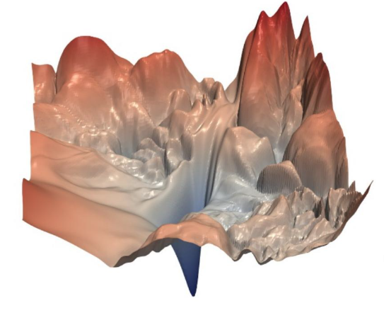
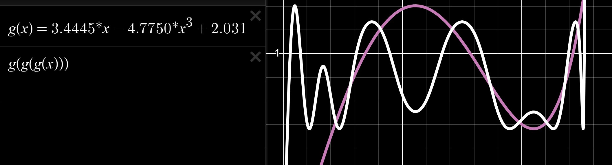

Sources:

- [www.lakernewhouse.com/writing/muon-1](https://www.lakernewhouse.com/writing/muon-1)
- [www.lakernewhouse.com/writing/muon-2](https://www.lakernewhouse.com/writing/muon-2)
- [Muon is Scalable for LLM Training](https://arxiv.org/abs/2502.16982)

 

*This post does not talk about the Newton-Schulz orthogonalization in detail, just about the general intuitions behind Muon.*

Let $\theta \in \mathbb{R}^d$ be the parameters of our neural network. 

We have a differentiable loss function $\mathcal{L}: \mathbb{R}^d \to \mathbb{R}$ that tells us how good our model performs.

We want to successively update $\theta^{(0)} \to \theta^{(1)} \to \dots \to \theta^{(T)}$ such that $\theta^{(T)} \approx \underset{\theta}{\operatorname{argmin}}{\mathcal{L}(\theta)}$.

Let $\Delta \theta$ denote such an update to our parameters. Each update is applied as follows
$$
\theta^{(t+1)} \gets \theta^{(t)} + \Delta \theta^{(t)}.
$$

We can frame the problem of finding an update $\Delta \theta$ as
$$
\Delta\theta^{(t)} \gets \underset{\Delta \theta}{\operatorname{argmin}}{\mathcal{L}(\theta^{(t)} + \Delta\theta)}.
$$

A Taylor expansion yields
$$
\mathcal{L}(\theta + \Delta\theta) = \mathcal{L}(\theta) + \nabla_{\theta}\mathcal{L}(\theta)^T \Delta\theta + \frac{1}{2} \Delta\theta^T \nabla^2_{\theta}\mathcal{L}(\theta) \Delta\theta + \dots.
$$

In first-order methods (such as SGD, Adam and Muon) we only keep the first derivative, that is we only look at the slope
$$
\mathcal{L}(\theta + \Delta\theta) \approx \mathcal{L}(\theta) + \nabla_{\theta}\mathcal{L}(\theta)^T \Delta\theta,
$$
looking at the curvature (Hessian) is very useful, however for large neural networks it is too computationally expensive ($\nabla^2_{\theta}\mathcal{L}(\theta) = \mathbf{H} \in \mathbb{R}^{d \times d}$).

At their core, gradient-based approaches have to manage the tension between taking a sufficiently large step in the direction of the slope, and not taking a step that is too large given that the slope only provides limited information.  

Let's continue looking at our finding-the-update problem, which we can now express as
$$
\Delta\theta \gets \underset{\Delta \theta}{\operatorname{argmin}} \mathcal{L}(\theta) + \nabla_{\theta}\mathcal{L}(\theta)^T \Delta\theta,
$$
and note that we can discard the constant, giving us
$$
\Delta\theta \gets \underset{\Delta \theta}{\operatorname{argmin}} \nabla_{\theta}\mathcal{L}(\theta)^T \Delta\theta.
$$

There is an issue here: because this problem linear and unconstrained, no minimizer exists. We therefore need to add a constraint. **Very neatly, different constraints on $\Delta \theta$ will allow us to recover many first-order methods, Muon included.** 

Another way of putting it is to say that we have to pick a mesure of what "one step" is. 

For example, let's add the following penalty
$$
\Delta\theta \gets \underset{\Delta \theta}{\operatorname{argmin}} \nabla_{\theta}\mathcal{L}(\theta)^T \Delta\theta + \frac{1}{2 \cdot lr} \Vert \Delta \theta \Vert_2^2,
$$
setting the derivative to 0 and solving for $\Delta \theta$ yields
$$
\Delta \theta \gets -lr \cdot \nabla_{\theta} \mathcal{L}(\theta),
$$
the plain SGD update.

One thing we can observe with SGD is that the step we take depends on the magnitude of the gradient. This makes sense: if the slope is steep, it is reasonable to take a larger step to converge faster. However, recall that this gradient information is only valid over a short distance, we can not trust it over large distances. (Probably there are many other reasons why this is bad in chaotic loss landscapes.)

{width=25%}

Let us try something different
$$
\Delta\theta \gets \underset{\Delta \theta}{\operatorname{argmin}} \nabla_{\theta}\mathcal{L}(\theta)^T \Delta\theta \quad \text{ subject to } \Vert \Delta \theta \Vert_{\infty} \leq lr,
$$
where the $l_{\infty}$ norm is defined as $\underset{i}{\max} \vert \Delta\theta_i \vert$.

This yields [signSGD](https://arxiv.org/abs/1802.04434)
$$
\Delta \theta \gets -lr \cdot \operatorname{sign}(\nabla_{\theta} \mathcal{L}(\theta)).
$$

This is interesting, because now the update does not depend on gradient magnitude. This can be seen as a simple way of bypassing the issues mentioned above about plain SGD: just take a fixed step no matter what the underlying gradient is.

We saw how two different constraints/penalties recover two well-known optimizers. Let's move on to Muon.

***

First, Muon is an optimizer for hidden matrix parameters (that map dense activations to dense activations). Intuitively this probably means that the constraint it uses is only defined for matrices. 

From now on we will focus on the update of a hidden matrix $\mathbf{W} \in \mathbb{R}^{\text{in} \times \text{out}}$ rather than the full set of parameters $\theta$. The non-matrix parameters (e.g. biases) are typically optimized using Adam.

A matrix is a linear transformation, it takes a vector and transforms it (rotates and/or stretches it). The constraint we want to use should be about *what matrices do* rather than just looking at their individual entries. 

First, let's define a measure of size for a vector $\mathbf{x} \in \mathbb{R}^{d}$. We will use the RMS norm
$$
\Vert \mathbf{x} \Vert_{\text{RMS}} = \sqrt{ \frac{1}{d} \sum_{i=1}^{d}{x_i^2}}
$$
which basically is an $l_2$ norm that is invariant to the number of the dimensions of our vector.

We can now define our measure of matrix size: the RMS-to-RMS norm
$$
\Vert \mathbf{W} \Vert_{\text{RMS} \to \text{RMS}} = \max(\{ \Vert \mathbf{Wx} \Vert_{\text{RMS}} : \Vert \mathbf{x} \Vert_{\text{RMS}} = 1 \}).
$$

For ease of notation let $\mathbf{G} = \nabla_{\mathbf{W}}\mathcal{L}(\theta)$. 

This norm measures the maximum stretch performed by the matrix $\mathbf{W}$. So it is actually a measure of what the matrix does, rather than what it contains. Interesting.

Let us once again formulate our problem, using our new constraint 
$$
\Delta\mathbf{W} \gets \underset{\Delta \mathbf{W}}{\operatorname{argmin}} \mathbf{G}^T \Delta\mathbf{W} \quad \text{ subject to } \Vert \Delta \mathbf{W} \Vert_{{\text{RMS} \to \text{RMS}}} \leq 1.
$$

We have defined what "one step" was, this also means that the learning rate can be interpreted as: each step changes the layer’s output by at most about $lr$% of its typical size.

The RMS-to-RMS norm can be rewritten in terms of the matrix spectral norm $\Vert \mathbf{W} \Vert_2 = \sigma_{\max}$ as follows
$$
\Vert \Delta \mathbf{W} \Vert_{{\text{RMS} \to \text{RMS}}} = \sqrt{\frac{\text{in}}{\text{out}}} \cdot \Vert \mathbf{W} \Vert_2,
$$
and let us then rewrite our problem using this new insight
$$
\Delta\mathbf{W} \gets \underset{\Delta \mathbf{W}}{\operatorname{argmin}} \mathbf{G}^T \Delta\mathbf{W} \quad \text{ subject to } \sigma_{\max} \leq 1.
$$

Now, let us replace both $\mathbf{G}$ and $\mathbf{\Delta W}$ by their singular value decompositions 
$$
\Delta\mathbf{W} \gets \underset{\Delta \mathbf{W}}{\operatorname{argmin}} \mathbf{V}_{\mathbf{G}} \mathbf{\Sigma}_{\mathbf{G}} \mathbf{U}^T_{\mathbf{G}} \mathbf{U}_{\Delta\mathbf{W}} \mathbf{\Sigma}_{\Delta\mathbf{W}} \mathbf{V}^T_{\Delta\mathbf{W}} \quad \text{ subject to } \Vert \Delta \mathbf{W} \Vert_{{\text{RMS} \to \text{RMS}}} \leq 1.
$$
and note that $\text{subject to } \Vert \Delta \mathbf{W} \Vert_{{\text{RMS} \to \text{RMS}}} \leq 1$ now simply means $\text{subject to } \mathbf{\Sigma}_{\Delta\mathbf{W}} = I$. Indeed, if we have a "budget" of at most 1 for each singular value, we might as well use it fully. This simplifies the problem
$$
\Delta\mathbf{W} \gets \underset{\mathbf{U}_{\Delta\mathbf{W}} \mathbf{V}^T_{\Delta\mathbf{W}}}{\operatorname{argmin}} \mathbf{V}_{\mathbf{G}} \mathbf{\Sigma}_{\mathbf{G}} \mathbf{U}^T_{\mathbf{G}} \mathbf{U}_{\Delta\mathbf{W}} \mathbf{V}^T_{\Delta\mathbf{W}} \quad \text{ subject to } \mathbf{U}_{\Delta\mathbf{W}}, \mathbf{V}^T_{\Delta\mathbf{W}} \text{ orthogonal}.
$$
and the solution to this is to maximize alignment, that is $\mathbf{U}_{\Delta\mathbf{W}} \mathbf{V}^T_{\Delta\mathbf{W}} \gets -\mathbf{U}_{\mathbf{G}}\mathbf{V}^T_{\mathbf{G}}$. The last step is re-multiply by the factor $\sqrt{\frac{\text{in}}{\text{out}}}$ **giving us the Muon update rule**
$$
\Delta \mathbf{W} \gets -lr \cdot \frac{\text{in}}{\text{out}} \cdot \mathbf{U}_{\mathbf{G}}\mathbf{V}^T_{\mathbf{G}}.
$$

The operation that consists in setting the singular values of $\mathbf{G}$ to be all equal to 1 is called *orthogonalization*.

***

However, computing the SVD for each layer at each iteration would be prohibitively expensive. Instead, Jeremy Bernstein found a way to do this in a much more efficient manner.

The method is called Newton-Schulz orthogonalization.

{width=50%}

