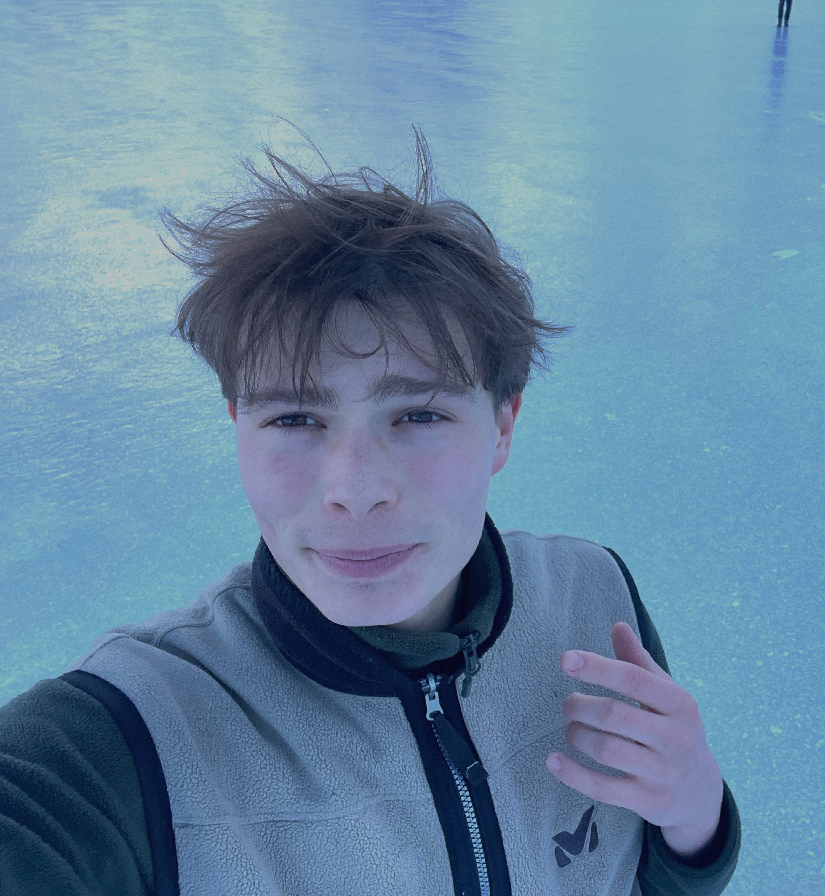

Hi I'm Maxime, an AI researcher working in Singapore (Genome Institute of Singapore).

Prior to that, I obtained my masters in computer science from KU Leuven (you can read my thesis [here](./docs/thesis.pdf)).

My interests in machine learning lie mainly in non-supervised approaches (such as ssl or rl).

I am open to PhD opportunities (starting in September 2027), so please do not hesitate to [contact me](https://mrochk.github.io/contact.html). 

***

[**github**](https://github.com/mrochk) &nbsp; &nbsp; &nbsp; &nbsp; &nbsp; &nbsp;  [**scholar**](https://scholar.google.com/citations?user=d8uMxiYAAAAJ) &nbsp; &nbsp; &nbsp; &nbsp; &nbsp; &nbsp; [**blog**](https://mrochk.github.io/blog.html)

***
